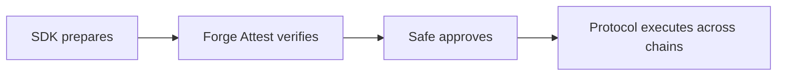

# crossecute

Run upgrades and other admin tasks across chains from one wallet, Safe, or DAO. Your team reviews and authorizes changes in one place.

- [Protocol](https://github.com/crossecute/protocol) sends instructions from your home chain and runs them on the destination chains.
- [SDK](https://github.com/crossecute/sdk) simulates the changes and prepares one Safe transaction for review.
- [Forge Attest](https://github.com/crossecute/forge-attest) reruns your script and checks that its output matches the transaction queued in Safe.

## Multichain multisig and governance comparison

✅ Yes · ❌ No in the documented workflow

| Capability | crossecute | Chainlink MCMS | LayerZero OneSig | Candide | Safe + Zodiac Bridge | Safe + Hyperlane ICA | Standard Safe | Wormhole MultiGov |
| --- | --- | --- | --- | --- | --- | --- | --- | --- |
| Execute on multiple chains | ✅ | ✅ | ✅ | ✅ | ✅ | ✅ | ✅ | ✅ |
| One signing round for a multichain batch | ✅ | ✅ | ✅ | ✅ | ✅ | ✅ | ❌ | ❌ |
| Signatures are verified on the destination | ✅ | ✅ | ✅ | ✅ | ❌ | ❌ | ✅ | ❌ |
| One multisig deployed on a home chain only | ✅ | ❌ | ❌ | ❌ | ❌ | ✅ | ❌ | ❌ |
| Nested multisig contracts as signers | ✅ | ❌ | ❌ | ✅ | ✅ | ✅ | ✅ | ❌ |
| Passkey signers | ✅ | ❌ | ❌ | ✅ | ✅ | ✅ | ✅ | ❌ |
| Supports token-voted proposals | ✅ | ❌ | ❌ | ❌ | ✅ | ✅ | ❌ | ✅ |
| Automatic destination execution from a home-chain dispatch | ✅ | ❌ | ❌ | ❌ | ❌ | ✅ | ❌ | ✅ |
| Cryptographically verifiable proposal scripts | ✅ | ❌ | ❌ | ❌ | ❌ | ❌ | ❌ | ❌ |
| Use the standard Safe app and hosted signature queue | ✅ | ❌ | ❌ | ❌ | ✅ | ✅ | ✅ | ❌ |

Destination signature verification refers to the original approvers' signatures. The script row counts tooling supplied by each project. Forge Attest also works with compatible Safe transactions from other workflows.

- **crossecute** works with an existing Safe using standard Safe transactions and Safe's hosted queue. In plain mode the home Safe can verify passkey signatures. With a compatible guard, Safe-signed mode verifies signatures from wallet keys and nested Safes on the destination. A DAO governor or its timelock can own the conduit and dispatch operations approved by token holders. Automatic execution depends on the delivery route. [SDK guide](https://github.com/crossecute/sdk/blob/main/docs/usage.md) · [Safe queue](https://docs.safe.global/core-api/safe-queue-service-reference) · [Safe passkeys](https://docs.safe.global/sdk/signers/passkeys) · [Safe-signed dispatch](https://github.com/crossecute/protocol/blob/main/docs/safe/safe-signed-dispatch.md) · [Message flow](https://github.com/crossecute/protocol/blob/main/docs/architecture/message-flow.md)
- **Chainlink MCMS** supports nested threshold groups of individual signers. Teams coordinate signing themselves and can add signatures to a proposal file with the SDK. Operators submit execution calls on the target chains. [Signer groups](https://github.com/smartcontractkit/ccip-owner-contracts#manychainmultisig-considerations) · [Signing](https://smartcontractkit.github.io/mcms/usage/signing-proposals/) · [Execution](https://smartcontractkit.github.io/mcms/usage/executing-proposals/)
- **LayerZero OneSig** uses a separate signature collection server in its reference workflow and also documents how to combine signatures locally. An executor submits the signed operation on each target chain. [OneSig protocol](https://github.com/LayerZero-Labs/onesig/blob/main/PROTOCOL.md)
- **Candide Safe Unified Account** uses AbstractionKit to sign multichain UserOperations. Each destination Safe verifies signatures, including WebAuthn passkeys and other contract signatures. Submission can use a hosted bundler or be done directly. [Passkey signing](https://docs.candide.dev/wallet/plugins/passkeys/) · [Safe Unified Account architecture](https://github.com/candidelabs/safe-4337-multi-chain-signature-module/blob/main/ARCHITECTURE.md) · [Submission options](https://docs.candide.dev/wallet/guides/walkaway-guide/#bundler)
- **Safe + Zodiac Bridge** lets a home Safe or DAO governor control a destination Safe through its bridge module. The documented bridge flow includes a destination submission step. [Bridge module](https://github.com/zodiaceco/zodiac-module-bridge#flow)
- **Safe + Hyperlane Interchain Accounts (ICA)** lets a home Safe or DAO governor send calls to a remote account. The destination authenticates the Hyperlane message. [Accounts API](https://github.com/hyperlane-xyz/hyperlane-quickstart#accounts-api) · [Router contract](https://github.com/hyperlane-xyz/hyperlane-monorepo/blob/main/solidity/contracts/middleware/InterchainAccountRouter.sol)
- **Standard Safe** supports nested Safes, passkey owners, and a hosted signature queue. Each chain has its own Safe deployment and approvals, even when the address is shared across chains. [Safe accounts](https://docs.safe.global/advanced/smart-account-overview) · [Multichain deployment](https://docs.safe.global/advanced/smart-account-multi-chain-deployment)
- **Wormhole MultiGov** tallies token votes from multiple chains on a hub and relays approved operations to their destinations. It authenticates dispatches through Wormhole messages. [Proposal flow](https://wormhole.com/docs/products/multigov/concepts/proposal-flow/)
