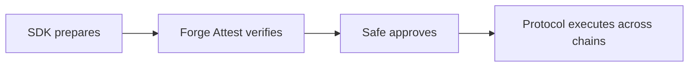

# crossecute

Run upgrades and other admin tasks across chains from one wallet, Safe, or DAO. Your team reviews and authorizes changes in one place.

- [Protocol](https://github.com/crossecute/protocol) sends instructions from your home chain and runs them on the destination chains.
- [SDK](https://github.com/crossecute/sdk) simulates the changes and prepares one Safe transaction for review.
- [Forge Attest](https://github.com/crossecute/forge-attest) reruns your script and checks that its output matches the transaction queued in Safe.

## Multichain multisig comparison

✅ Yes · ❌ No in the documented workflow

| Capability | crossecute | Chainlink MCMS | LayerZero OneSig | Candide Safe Unified Account |
| --- | --- | --- | --- | --- |
| Execute on multiple chains | ✅ | ✅ | ✅ | ✅ |
| One signing round for a multichain batch | ✅ | ✅ | ✅ | ✅ |
| One multisig deployed on a home chain only | ✅ | ❌ | ❌ | ❌ |
| Nested multisig contracts as signers | ✅ Nested Safes | ❌ Signer groups | ❌ | ✅ Contract signers on each chain |
| Automatic destination execution from a home-chain dispatch | ✅ With automatic delivery | ❌ | ❌ | ❌ |
| Rerun a pinned script and verify the resulting transaction by hash | ✅ Forge Attest | ❌ | ❌ | ❌ |
| Requires a self-hosted signature collection backend | ❌ | ❌ | ❌ Reference flow uses a server | ❌ |

- **crossecute** uses receivers on each destination. Safe-signed mode verifies nested Safe approvals, and automatic execution depends on the delivery route. [Message flow](https://github.com/crossecute/protocol/blob/main/docs/architecture/message-flow.md) · [Safe-signed dispatch](https://github.com/crossecute/protocol/blob/main/docs/safe/safe-signed-dispatch.md)
- **Chainlink MCMS** supports nested threshold groups of individual signers. Its SDK collects signatures into a proposal and submits execution calls on the target chains. [Signer groups](https://github.com/smartcontractkit/ccip-owner-contracts#manychainmultisig-considerations) · [Signing](https://smartcontractkit.github.io/mcms/usage/signing-proposals/) · [Execution](https://smartcontractkit.github.io/mcms/usage/executing-proposals/)
- **LayerZero OneSig** describes a server for collecting signatures and shows how to combine them locally. An executor submits the signed operation on each target chain. [OneSig protocol](https://github.com/LayerZero-Labs/onesig/blob/main/PROTOCOL.md)
- **Candide** verifies contract signatures through the Safe on each target chain. Signed operations can go through a hosted bundler or be submitted directly. [Safe Unified Account architecture](https://github.com/candidelabs/safe-4337-multi-chain-signature-module/blob/main/ARCHITECTURE.md) · [Submission options](https://docs.candide.dev/wallet/guides/walkaway-guide/#bundler)
