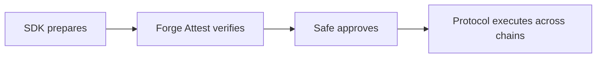

# crossecute

Run upgrades and other admin tasks across chains from one wallet, Safe, or DAO. Your team reviews and authorizes changes in one place.

- [Protocol](https://github.com/crossecute/protocol) sends instructions from your home chain and runs them on the destination chains.
- [SDK](https://github.com/crossecute/sdk) simulates the changes and prepares one Safe transaction for review.
- [Forge Attest](https://github.com/crossecute/forge-attest) reruns your script and checks that its output matches the transaction queued in Safe.
