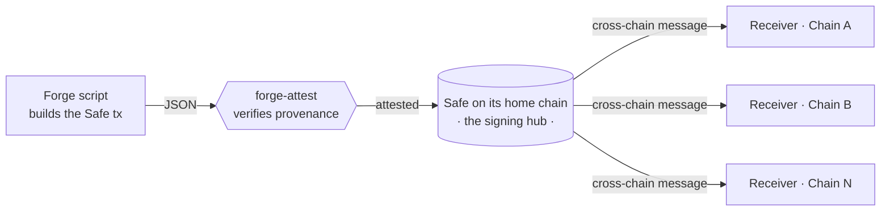

<picture>
  <source media="(prefers-color-scheme: dark)" srcset="https://raw.githubusercontent.com/crossecute/.github/main/brand/crossecute-icon-black.png" />
  
</picture>

**One multisig, on the chain you trust. Control on every other.**

---

## The idea

A protocol on many chains ends up running a separate multisig on each one. Every
one has its own signers, its own nonces, and its own signing steps. Each extra
place you sign is another place to get phished, send the wrong payload, or lose
quorum.

crossecute reduces that to one signing hub. A single [Safe](https://safe.global)
holds the authority. The actions it approves are carried to any destination chain
and run there. You sign once, on the chain you trust most, and the operation lands
everywhere.

You pick which chain that is, and nothing in the protocol favors one. Every chain
runs the same contracts, so any of them can be a home. The protocol calls each
owner's cross-chain account a *conduit*. A conduit's home is the chain it was
created on, chosen per conduit rather than once for everyone. Nothing is
configured per conduit: once the chains are connected, the first message from a
conduit's home creates its receiver on the destination, at the same address.

The hard part is not the messaging. It is trusting what you sign. An operator
builds a transaction with a script in one repo and submits it to the Safe in
another. How does a signer know the thing in the queue is exactly what the script
produced, and was not changed on the way? That gap is where crossecute starts.

## Building blocks

| Repo | What it does | Status |
|------|--------------|--------|
| [**forge-attest**](https://github.com/crossecute/forge-attest) | Proves a submitted Safe transaction is byte for byte the output of a specific Forge script at a pinned commit. It reproduces the script, derives the Safe tx hash three independent ways, and checks it against the live Safe queue. Handles single transactions, Transaction Builder batches, nested Safes, and one transaction per chain from a single config. `--attest` lets each owner sign and submit once the checks pass. Ships as a CLI, a GitHub Action, and a Claude Code plugin. Chain-agnostic. | ✅ [v1.1.0](https://github.com/crossecute/forge-attest/releases/tag/v1.1.0) |
| [**forge-attest-example-safe-ops**](https://github.com/crossecute/forge-attest-example-safe-ops) | A reference producer repo: deterministic Forge scripts that build a single Safe tx and a Transaction Builder batch, both verified by forge-attest. | ✅ Available |
| [**protocol**](https://github.com/crossecute/protocol) | The cross-chain executor. An owner's conduit holds the same address on every chain, homed on whichever chain they created it on. The half on that home sends; the half on every other chain receives and runs what arrives, either on arrival or later against an approval. Covers conduit creation, the approval map, cancellation, and both message paths, with native bindings for LayerZero, CCIP, Hyperlane, Wormhole, and OP Stack (L1 ↔ L2 and L2 ↔ L2), plus `layerzero-oft` through an operator's own OFT. Send and receive follow ERC-7786. | 🚧 In progress |

The org also keeps forks of [forge-std](https://github.com/crossecute/forge-std),
[openzeppelin-contracts](https://github.com/crossecute/openzeppelin-contracts), and
[openzeppelin-contracts-upgradeable](https://github.com/crossecute/openzeppelin-contracts-upgradeable),
which protocol pins as submodules.

## Principles

- **Do not trust, verify.** Every artifact can be rebuilt and checked by anyone.
  Provenance is worked out from the artifact, never asserted.
- **One signing surface.** Fewer multisigs, fewer nonces, fewer ways to be tricked.
- **The anchor is a choice, not a constant.** Each conduit picks its home chain
  when it is created. Centralize where your trust already is.
- **Composable, not monolithic.** Each piece (provenance, execution, tooling)
  stands alone and is useful on its own.

## Status

Early. The verification layer is public and released as forge-attest v1.1.0.
The protocol's EVM contracts are built and tested, but every message provider is
so far tested against a mock, and nothing has crossed a real bridge yet. Issues
and questions are welcome on any repo above.
